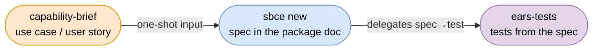

# capability-brief

An [AIrails.dev](https://airails.dev) skill that captures one capability, or one addition to a
capability, as a **brief** — a use case or a user story complete enough that
[`/sbce new`](../sbce) authors the spec in one shot. The clarifying interview `new` runs
against a vague feature description moves here, to authoring time with the domain owner, and its
answers are recorded once.

## Scope

- Three modes, one skill — invoke as `/capability-brief uc|story|review <description-or-file>` (or by intent, mode omitted):
  - **uc** — a **use case** for a new capability with several steps, actors or kept state
  - **story** — a **user story** for one behaviour added to an existing capability, or a new capability with a single operation
  - **review** — run the checklist over an existing brief and complete only its gaps
- Mode omitted: the skill routes by the input's shape (kept state or several calls → use case, an addition to an existing capability → story) and switches when the shape changes. Mode given: the author's choice stands; when the input outgrows it, the skill warns and asks instead of switching
- An **interview** that fills the template from the author's words, scans the repository read-only (existing package docs, the system doc's decisions and language, whether a stack is declared), reports what it found — existing capabilities and operations that overlap the request, reuse candidates, overloaded terms and name clashes — then asks one gap per question — only what a human can answer: result shape, input parts and validation, repeated requests, external failures, lifecycle end, rejected alternatives
- A **completeness checklist** every brief passes before it is emitted: no unacknowledged overlap with an existing capability and no overloaded term, every actor step named as an operation, every input with its parts, every operation with its failure cases, every supporting actor tagged as a capability or external, lifecycle and entities stated or `none`, decisions with rejected alternatives, open issues holding only unanswered questions
- Stack-neutral — what the system promises, never how it is built; a type, transport or framework offered by the author is kept out
- The brief is **inception input, not a source of truth** — the same status as the README seed `/sbce new` reads. Once the spec exists in the package doc, the spec is authoritative
- Templates: [references/use-case-template.md](references/use-case-template.md), [references/user-story-template.md](references/user-story-template.md); each carries a filled example and states how its sections become the spec

## Composition

- [`sbce`](../sbce) consumes the brief: its `new` mode treats a filled brief as the completed clarify loop, its `## Capability` as the confirmed carving, each `record:` as a confirmed decision, and asks only what `## Open issues` lists
- [`ears-tests`](../ears-tests) is downstream of the spec; a brief never contains test wording
- No stack skill is involved; the brief is upstream of any stack



## Usage

Invoke `/capability-brief <mode> <description>` or describe the capability in domain language and
let the skill pick the format. It interviews until the checklist passes and prints the filled
brief. Save it where you like (`<capability>-brief.md` beside the repository `README.md` is the
default), read it, then hand it to `/sbce new <file>`. Two commands on purpose: the pause between
them is where the domain owner signs off before the brief becomes a spec.

## Templates

Written for the domain expert or business analyst who fills in the brief. You need no technical
knowledge. A template asks what the system promises: who uses it, what they ask for, what they get
back, and what happens when something goes wrong. The skill fills in what it can from your
description and asks you only about the gaps. A blank section turns into a question later; a
guessed answer turns into behaviour nobody asked for.

### Which template

| You describe… | Template | Example |
|---|---|---|
| a new process with several steps or participants, or something the system must remember between steps | [Use case](references/use-case-template.md) | a shopper browses, selects products, pays and confirms |
| one new behaviour of an existing process, or a process that is a single request and answer | [User story](references/user-story-template.md) | a shopper searches products by keyword |

The skill picks the template for you. If a story turns out to hide several steps or something the
system must remember, the skill suggests switching to a use case.

### Use case

| Section | What you answer |
|---|---|
| Capability | the business area responsible, in one word; whether it is new or extends an existing one; the goal the person reaches; one sentence on what the system promises |
| Actors | who starts the process, and who or what it relies on: another part of the system, or an outside party such as a payment provider or a sales advisor |
| Main scenario | the steps when everything goes well, starting with the event that starts the process. The last step says exactly what comes back: which details, in which order, how many at most, and what is said when nothing is found |
| Inputs | each piece of information the person provides: its parts, which parts are mandatory, and when it counts as invalid. Invalid information is always rejected, naming what is wrong |
| Extensions | everything else that can go wrong or go differently, tied to its step: nothing to act on, something missing, an outside party unavailable, the same request sent twice, the person walking away. Optional paths are marked |
| Lifecycle | what the system remembers between steps, and when that starts and ends — e.g. a selection kept until purchase or expiry; otherwise `none` |
| Entities | the things the system keeps track of, names only — e.g. Selection, Order |
| Out of scope | what was considered and deliberately left out |
| Decisions | each choice with the alternatives rejected — e.g. payment is taken only at confirmation, not when the card details are entered |
| Open issues | questions nobody could answer yet; these are the only questions asked later |

<details>
<summary>Filled example: <code>leave</code>, use case "request leave"</summary>

```markdown
## Capability
- name: `leave`
- kind: new
- goal: an employee gets a decided leave request for a period of time off
- responsibility: take an employee's leave request, have it decided by their manager and keep the leave balance and the team calendar in line with the decision

## Actors
- primary: an employee
- supporting: the employee's manager — external; approves or rejects the request
- supporting: the HR system — external; the leave balance of each employee and the assignment of employees to managers
- supporting: the team calendar — external; shows approved leave to the team

## Main scenario
1. `request-leave` — the employee submits the leave type, the first and the last day, and an optional note.
2. The system counts the working days in the period, checks them against the employee's balance in the HR system, records the request as pending and informs the employee's manager.
3. `decide-leave` — the manager approves the request.
4. The system deducts the days from the balance in the HR system, enters the absence in the team calendar and informs the employee with the decided request: request number, leave type, first and last day, working days taken, decision, and remaining balance.

## Inputs
- leave request: leave type (annual, unpaid, special), first day, last day, note; required: type, first day, last day; invalid when the type is unknown, the first day is in the past, or the last day is before the first day
- decision: approve or reject, reason; required: the decision, and a reason when rejecting; invalid when a rejection has no reason

## Extensions
- 1a. the period contains no working day -> reject it; there is nothing to request
- 1b. the period overlaps a pending or approved request of the same employee -> reject it and name the overlapping request
- 1c. annual leave exceeds the remaining balance -> reject it and state the remaining balance
- 1d. the same request is submitted a second time -> create no second request; return the existing one
- 2a. the HR system is unavailable -> record the request as pending with the balance unchecked, and check the balance again before the manager decides
- 2b. no manager is assigned to the employee -> record the request as pending and inform HR to assign one
- 3a. the manager rejects the request -> close it as rejected, keep the balance unchanged and inform the employee with the reason
- 3b. the request is no longer pending -> reject the decision and report the request's current state
- 3c. the manager does not decide within 10 working days -> pass the request to the next-level manager and inform the employee
- 4a. the HR system is unavailable -> the approval stands; deduct the days as soon as the HR system is available
- 4b. the team calendar is unavailable -> the approval stands; enter the absence as soon as the calendar is available
- *a. the employee withdraws a pending request (`withdraw-leave`) -> close it as withdrawn and inform the manager
- *b. the employee withdraws an approved request before its first day -> return the days to the balance, remove the calendar entry and inform the manager

## Lifecycle
- one request per submission, pending from submission until approved, rejected or withdrawn; an approved request ends after its last day or when withdrawn before its first day

## Entities
- LeaveRequest

## Out of scope
- reporting sick leave — a separate capability with no approval
- calculating the yearly entitlement — owned by the HR system
- payroll effects of unpaid leave — owned by payroll

## Decisions
- record: one capability `leave` from request to decision _(rejected: separate `request` and `approval` capabilities)_
- record: the balance stays in the HR system and is checked at request and before the decision _(rejected: keeping a copy of the balance)_
- record: an undecided request goes to the next-level manager after 10 working days _(rejected: automatic approval; waiting without limit)_

## Open issues
- may an approved request be withdrawn after its first day, and are the remaining days returned?
- must the manager see who else in the team is absent in the requested period before deciding?
```

</details>

### User story

| Section | What you answer |
|---|---|
| Story | "As a *role*, I want *action* so that *outcome*." |
| Capability | the business area; whether it is new or extended; what it relies on; the things it keeps track of. The skill names the requests the story adds |
| Inputs | as in the use case |
| Acceptance criteria | one short scenario per behaviour: *Given* the situation, *When* the person does something, *Then* the system answers. Cover the failures too: nothing found, an outside party unavailable, a repeated request. The *Then* of the success scenario states the exact result |
| Lifecycle, Out of scope, Decisions, Open issues | as in the use case |

### What stays out

No technical terms: no screens, data types, protocols, products or file names. If a technical
preference is really a business choice, it is written down under Decisions in business terms.

### After sign-off

You read and approve the brief; the developers then turn it into the specification. From that
point the specification is authoritative and the brief is not updated.

Each template ends with a filled example from an online music store — a use case for "browse and
shop" and a user story for keyword search; the use case above adds "request leave" from everyday
office work. Read one before your first interview.

## Example Prompts

- `/capability-brief uc "a shopper browses the store and buys products"`

  New capability with several steps and a kept selection: use case; the interview asks for the result shape, the parts of payment and delivery details, what a second confirmation does, and when the selection expires.

- `/capability-brief story "as a shopper I want to search products by keyword"`

  Addition to the existing `shop` capability: user story; the interview asks for the match rule, ordering, limit, minimum keyword length and the response when stock control is unavailable.

- `/capability-brief story "as a shopper I want to keep products in a wishlist across visits"`

  Explicit mode outgrown: the wishlist is kept state, so the skill warns that the story hides a lifecycle and asks whether to continue as story or switch to a use case — it never switches on its own once a mode was given.

- `/capability-brief review shop-brief.md`

  Review: runs the checklist over the file, asks only for the rows that fail, and returns the completed brief.

- `write a use case for the returns process`

  Mode omitted, triggered by intent: the skill routes by shape (several steps, a returned item tracked across them → use case) and says so.

## Test

```
/capability-brief story "as a librarian I want to register a returned book"
```

Then, on the emitted brief:

```
/sbce new library-brief.md
```

`new` should author the spec without a question beyond the brief's `## Open issues`.
