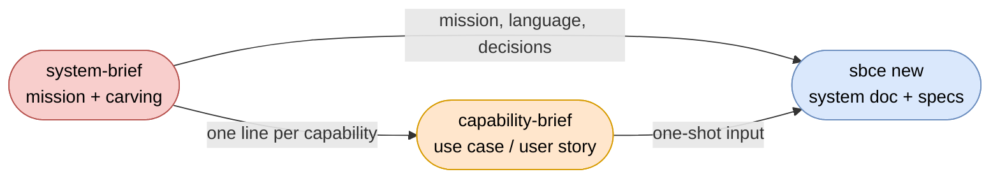

# system-brief

An [AIrails.dev](https://airails.dev) skill that captures one system — the whole assembly of
capabilities — as a **system brief**: a mission, the actors, and the carving into named
capabilities, complete enough that each capability line is a one-shot input to
[`/capability-brief`](../capability-brief) and the mission, language and decisions seed the
[`/sbce`](../sbce) system doc. The stakeholder conversation that otherwise happens in fragments
across the first ten capability interviews is moved here, to inception, and its answers are
recorded once.

## Scope

- Two modes, one skill — invoke as `/system-brief new|review <description, notes, or file>` (or by intent, mode omitted):
  - **new** — a system that does not exist yet, or an existing system without a system brief or system doc
  - **review** — run the checklist over an existing system brief, or over a pitch, notes or a product requirements document, and complete only the gaps
- **Any text as input** — a sentence, a pitch, meeting notes, a product requirements document. The minimum is one outcome the system should deliver for someone; everything else is asked. Text naming only a solution is answered with one question for the outcome; text describing a single capability is handed to `/capability-brief` — a one-capability system needs no system brief, as a one-BC system needs no system doc
- An **interview** that fills the template from the stakeholders' words — only what they state; vague wording ("the usual HR stuff") is a gap, contradicting passages become one question — reads back what it took from the input, scans the repository read-only (system doc, existing package docs, README seed, declared stack), reports what it found, then **proposes the carving** with the alternative it rejected and asks for confirmation. Carving has no test oracle; the stakeholders' confirmation is the only one it gets
- **Carving guidance** in domain terms: one responsibility an actor would name, one party who decides its rules; too coarse when an "and" joins two outcomes, too fine when the line is a step of another capability, wrong when two lines cannot be described without each other
- A **completeness checklist** every brief passes before it is emitted: every actor in a capability, every capability one word tagged `new`, `extends` or `existing` with one sentence and a named actor, no operations or inputs inside a line, no overlapping responsibilities left unresolved, capabilities in build order with a reason for the first, every shared noun defined once, invariants spanning two or more capabilities, decisions with rejected alternatives, open issues holding only unanswered questions
- Stack-neutral and inside-neutral — why the system exists and which capabilities it needs; a capability's operations and inputs are carried forward as notes for its own brief, never written into this one
- The brief is **inception input, not a source of truth** — the same status as a capability brief and the README seed. Once the system doc and the specs exist they are authoritative; the capability list is not kept in sync, the README projection regenerates its BC map from the package docs instead
- Template: [references/system-brief-template.md](references/system-brief-template.md); it carries a filled example and states how its sections become downstream artifacts

## Composition

- [`capability-brief`](../capability-brief) consumes one capability line at a time: name and tag become `name` and `kind` — `new` or `extends`; an `existing` capability is reused as it is and gets no brief — the actor the `primary` actor, the system's external systems the `external` supporting actors, the carried notes the start of its interview
- [`sbce`](../sbce) consumes the whole: `## Capabilities` is the proposed carving, `## System` seeds the mission and vision, `## Interactions`, `## Language` and `## Invariants` seed `## Components`, `## Ubiquitous language` and `## System invariants`, each `record:` is a confirmed `Dn`. The system doc is authored there, never here
- [`bce`](../bce) judges a cut, it does not make one: its cohesion and coupling rules decide whether a carving is legal, the stakeholders decide which carving is wanted
- No stack skill is involved; the brief is upstream of any stack
- The migration skills ([`migration-advisor`](../../migrations/migration-advisor), [`bc-carver`](../../migrations/bc-carver)) do the same for a legacy system from its code; this skill does it for a greenfield system from its stakeholders. Both end in the same system doc



## Usage

Invoke `/system-brief new <description>` or describe the system you want to build and let the
skill trigger. It interviews until the checklist passes, proposes the carving for your
confirmation, and prints the filled brief followed by the carried notes per capability. Save it
where you like (`system-brief.md` beside the repository `README.md` is the default), read it, then
run `/capability-brief "<one-liner>"` for each capability in build order and `/sbce new` when the
briefs exist. The pause between the steps is where the stakeholders sign off the carving before it
becomes packages.

## Template

Written for the product owner, sponsor or business analyst who answers for the system as a whole.
You need no technical knowledge, and you need not know what a business component is: describe
what the system is for and who uses it, in your own words, and the skill proposes how to divide
it. It reads back what it understood before asking anything, so correct it there; it never fills in
a value you did not state, and it never divides the system without asking you first.

| Section | What you answer |
|---|---|
| System | a one-word name; one sentence on what the whole system promises; optionally one sentence on the outcome you are chasing |
| Actors | who uses the system and what each of them achieves; which outside systems it relies on and for what |
| Capabilities | the areas of responsibility the system consists of, one line each: who it is for and what they get; in the order you want them built, and why the first one is first. The skill proposes this list and you confirm or correct it |
| Interactions | which area relies on which other area or outside system, if you already know; otherwise "none known yet" |
| Language | the words that appear in more than one area, each defined once, so two areas never mean two things by one word |
| Invariants | rules that hold across the whole system, not inside one area — e.g. nobody decides their own request |
| Success measures | how you will know the system delivers; things you can observe, not features |
| Out of scope | what was considered and deliberately left out, and why |
| Decisions | each choice with the alternatives rejected — e.g. leave and expenses are separate, because different people own their rules |
| Open issues | questions nobody could answer yet; these are the only questions asked later about the system |

### What stays out

Nothing about how an area works inside — no steps, no forms, no fields — and nothing technical.
What you say about an area's inside is kept as notes and used when that area's own brief is
written. A technology preference that is really a business decision is written down under
Decisions in business terms.

### After sign-off

You read and confirm the division into areas; then each area gets its own brief, and the
developers turn the briefs into specifications. From that point the specifications and the system
doc are authoritative and this brief is not updated.

The template ends with a filled example: an HR self-service portal carved into `leave`,
`expenses`, `onboarding` and an existing `directory`. Read it before your first interview.

## Example Prompts

- `/system-brief new "an HR portal where employees handle leave, expenses and onboarding themselves"`

  Greenfield: the interview asks who decides requests, which outside systems hold balances and payroll, where leave ends and expenses begin, which area is built first; it proposes four capabilities and names the rejected single `requests` capability.

- `/system-brief new "we need a Kubernetes platform for the shop"`

  Solution named, outcome missing: one question — what should someone be able to do once it exists — and the interview continues from the answer; the platform is kept out as stack.

- `/system-brief review product-requirements.md`

  Review of plain text: the template is filled only from what the document states, read back, then asked for the gaps; chapters are not taken as capabilities, responsibilities are.

- `/system-brief new "a shopper searches products by keyword"`

  One capability: the skill says so and hands the sentence to `/capability-brief`.

- `scope the conference system before we start carving`

  Mode omitted, triggered by intent: `new`, since no brief exists.

## Test

```
/system-brief new "a library where members borrow and return books and librarians manage the catalogue"
```

Then, for the first line of the emitted brief:

```
/capability-brief "<the first capability line>"
```

`/capability-brief` should start from the system's actors and external systems and the carried
notes, asking nothing the system brief already answers.
