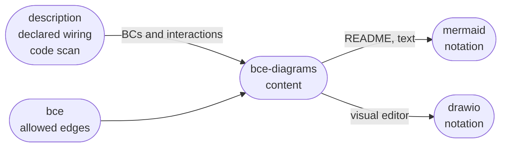

# bce-diagrams

An [AIrails.dev](https://airails.dev) skill creating high-level overview diagrams of a [Boundary-Control-Entity (BCE/ECB)](https://bce.design) application: the interactions between its business components (BCs), subsystems, and external services. It decides what the diagram shows; [mermaid](../mermaid) or [drawio](../drawio) draws it.

## Scope

- Two detail levels:
  - **between components** — each BC is one opaque node, subsystems group related BCs, external dependencies are separate nodes
  - **within components** — each BC is a group holding only the layers it has; a cross-BC edge ends at another BC's control or entity, never at its boundary; an external dependency hangs off the control that calls it
- Content from the first source that applies: the user's description, the declared wiring (`## Components` in the [sbce](../../bce/sbce) system doc — drawn exactly, never extended from code), a scan of the package or directory structure
- Detail level and format are taken from the request and its target; only what remains open is asked. A diagram destined for a `README.md` in a GitHub project is Mermaid
- Asynchronous interactions are distinguished from synchronous calls

No class diagrams, no sequence diagrams.

## Composition

- [`bce`](../../bce/bce) defines BC, boundary, control, entity and the allowed dependencies; only edges those rules allow are drawn
- [`mermaid`](../mermaid) and [`drawio`](../drawio) own the notation: shapes, colours, layout, the async edge style. Both carry an example per detail level
- [`sbce`](../../bce/sbce) declares the wiring this skill projects, and delegates the style of its generated README diagram here
- The stack skill names what fulfills each layer and how a cross-BC reference appears in code



## Usage

```
/bce-diagrams                                   # BCs of the current project
/bce-diagrams orders, payments and the payment gateway
/bce-diagrams show the layers of orders and payments as draw.io
```

Or by intent:

- `add a BC overview to the README` — nothing is asked: "BC overview" settles between components, the README target settles Mermaid
- `draw the architecture of this project` — asks for detail level and format in one question, then delegates
