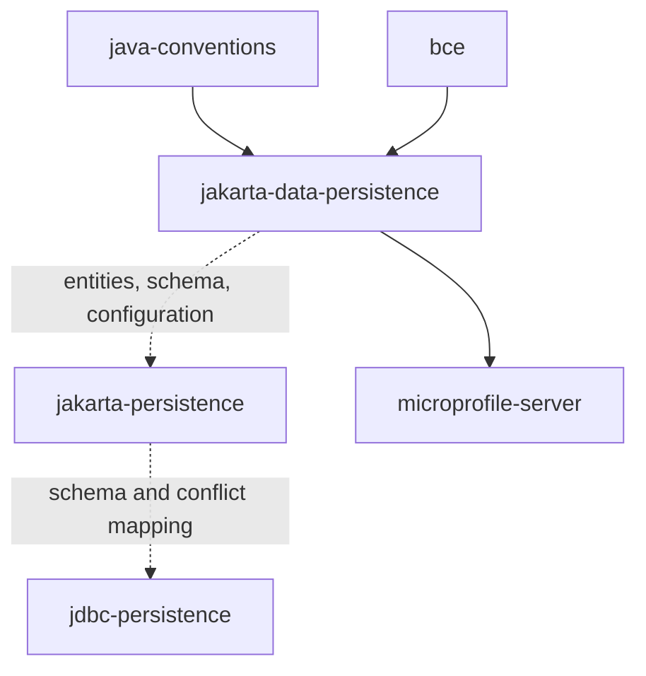

# jakarta-data-persistence

An [AIrails.dev](https://airails.dev) skill for persisting and querying Jakarta Persistence entities through Jakarta Data 1.0 repositories in MicroProfile / Jakarta EE servers: a repository method is one statement, executed when it is called; there is no persistence context, so every update is an explicit call; the schema is hand-written and the mapping is validated against it.

## Scope

- `@Repository` interfaces in `control`, named after responsibilities, without built-in supertypes; the implementation is generated by the provider's annotation processor
- Explicit `@Insert`, `@Update`, `@Delete`; no `@Save`, no cascade, no dirty checking — a changed entity is passed to `update`
- `@Find` methods with parameters named after entity fields, checked for name and type at compile time
- `@Query` with JPQL in text blocks for comparisons, projections, aggregates, `join fetch`, and bulk statements; record projections through constructor expressions
- No queries derived from method names: every abstract method carries an annotation
- Boundary-owned unit of work: `@Transactional` on the class or the `@Boundary` stereotype; the boundary calls the repository directly
- Conflicts translated in a `default` method of the repository by SQLState: `23505` / `23503` and `OptimisticLockingFailureException` become `ClientErrorException(CONFLICT)`, everything else `InternalServerErrorException`
- Entity mapping, Flyway schema, configuration, and health as in [`jakarta-persistence`](../jakarta-persistence)
- Round-trip tests against the production DBMS, each inside a rolled-back transaction; every `@Query` method executed by a test
- Runtime specifics kept out of the rules: the Jakarta Data API, the annotation processor, and provider behavior on Quarkus in [references/quarkus.md](references/quarkus.md); provider, driver, Flyway, configuration keys, and test support in the [Quarkus reference of `jakarta-persistence`](../jakarta-persistence/references/quarkus.md)

Picked on demand: on Jakarta Data wording in the request or an existing `jakarta.data-api` dependency. An unqualified request to persist uses [`memory-persistence`](../memory-persistence). Boundary calls that change a loaded graph of entities belong to [`jakarta-persistence`](../jakarta-persistence), plain SQL to [`jdbc-persistence`](../jdbc-persistence). Not for Spring Data, CLI applications, or NoSQL stores.

## Composition



[`bce`](../../bce/bce) owns BC carving and layer placement, [`java-conventions`](../java-conventions) owns syntax and style, and [`microprofile-server`](../../bce/microprofile-server) owns build, configuration, lifecycle, and the test loop. `jakarta-data-persistence` adds only how a BC reaches the database through a repository.

## Usage

Activated when a MicroProfile server project persists with Jakarta Data: adding repositories, `@Find` or `@Query` methods, or entities stored through them. The rules in [SKILL.md](SKILL.md) guide generation and review.

## Test

Clone the server sample:

```
git clone https://github.com/adambien/quarkus-microprofile
```

Then use the following prompt:

```
persist the coffee BC with Jakarta Data
```
