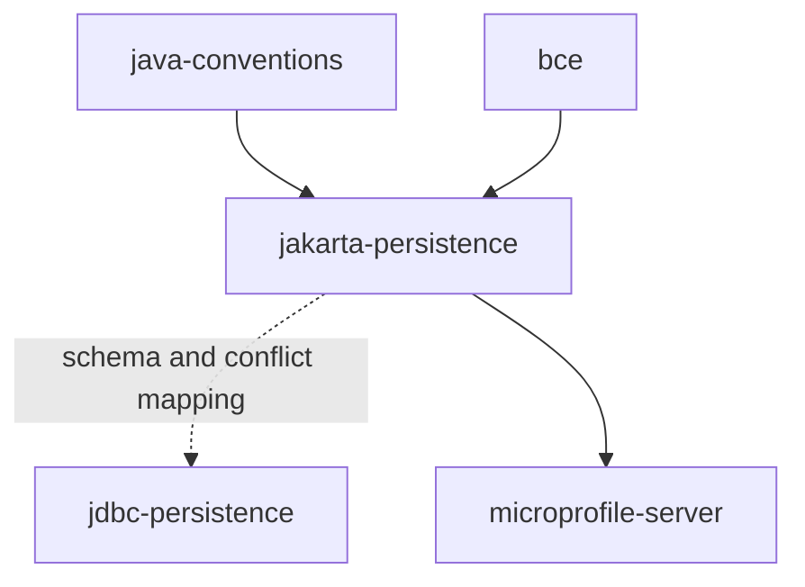

# jakarta-persistence

An [AIrails.dev](https://airails.dev) skill for persisting and querying entities with Jakarta Persistence 3.2 in MicroProfile / Jakarta EE servers: entities are classes with state and behavior, managed inside the boundary's transaction; records carry embeddable value objects and projections; the schema is hand-written and the mapping is validated against it.

## Scope

- `@Entity` classes in `entity` with field access, package-private fields, state-changing methods instead of setters, `toJSON()` / `fromJSON`; record `@Embeddable`s, record primary key classes, record projections
- `EntityManager` injected into the boundary for plain create, read, replace (`merge`, full replacement only), and remove; a partial change is a method call on the managed entity, written at commit
- Controls only where they add to the `EntityManager` call: conflict handling, operations other BCs call, logic across entities; named after responsibilities, no repositories
- JPQL in text blocks as named queries, typed execution, `getSingleResultOrNull()`, constructor-expression projections
- Lazy associations throughout; fetching stated per query with `join fetch`
- Boundary-owned unit of work: `@Transactional` on the class or the `@Boundary` stereotype
- Conflicts translated once, in the control, after an explicit `flush()`: SQLState `23505` / `23503` and `OptimisticLockException` become `ClientErrorException(CONFLICT)`, everything else `InternalServerErrorException`
- Flyway migrations per BC with named constraints, as in `jdbc-persistence`; the provider validates the mapping against it and never generates the schema
- Round-trip tests against the production DBMS, each inside a rolled-back transaction
- Runtime specifics kept out of the rules: Quarkus extensions, configuration keys, `@QuarkusTest`, and `@TestTransaction` in [references/quarkus.md](references/quarkus.md)
- `jakarta.persistence.*` imports only; 3.2 APIs used only when the project's BOM resolves 3.2

Picked on demand: on JPA wording in the request or an existing provider dependency. An unqualified request to persist uses [`memory-persistence`](../memory-persistence). Not for plain SQL — use [`jdbc-persistence`](../jdbc-persistence). Not for CLI applications and not for NoSQL stores.

## Composition



[`bce`](../../bce/bce) owns BC carving and layer placement, [`java-conventions`](../java-conventions) owns syntax and style, and [`microprofile-server`](../../bce/microprofile-server) owns build, configuration, lifecycle, and the test loop. `jakarta-persistence` adds only how a BC reaches the database through a persistence context.

## Usage

Activated when a MicroProfile server project persists with Jakarta Persistence: adding entities, associations, JPQL queries, or `EntityManager` access in a boundary or control. The rules in [SKILL.md](SKILL.md) guide generation and review.

## Example

See [ebank](https://github.com/AdamBien/ebank) for a Quarkus application with Jakarta Persistence and PostgreSQL.

## Test

Clone the server sample:

```
git clone https://github.com/adambien/quarkus-microprofile
```

Then use the following prompt:

```
persist the coffee BC with Jakarta Persistence
```
