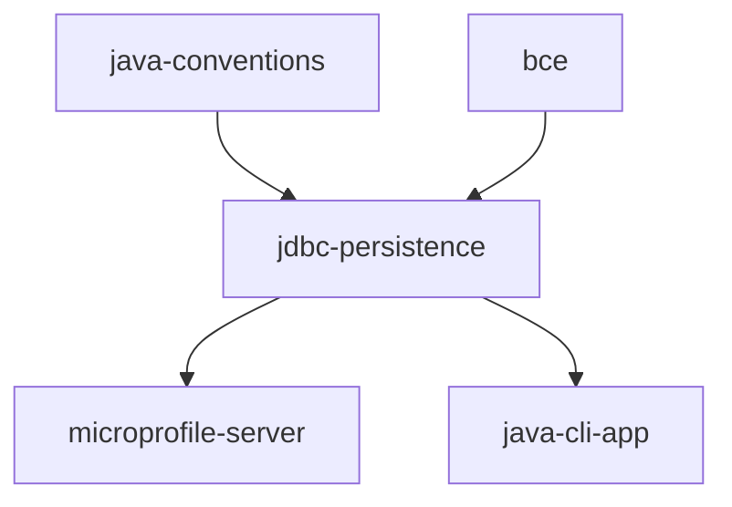

# jdbc-persistence

An [AIrails.dev](https://airails.dev) skill for persisting and querying Java records with plain JDBC, following Data-Oriented Programming: the record is the row shape, the sealed interface is the closed set of variants, and the control moves data between the two with explicit SQL. No ORM, no annotations, no generated SQL.

## Scope

- Records in `entity` as row shapes and projections, sealed interfaces for variants — free of `java.sql`
- Controls named after responsibilities, spanning the tables of their BC: `@ApplicationScoped` CDI beans with an injected `DataSource` on the server, as interfaces with `static` functions over a `Connection` in a CLI; SQL in text blocks, `?` binding, explicit column lists
- Exhaustive `switch` mapping in both directions between a sealed type and its discriminator column
- Boundary-owned unit of work: `@Transactional` on the server, explicit commit in a CLI
- `SQLException` translated at the control: integrity violations become `IllegalArgumentException`, the rest `IllegalStateException`
- Hand-written DDL per BC; Flyway on the server, idempotent `CREATE TABLE IF NOT EXISTS` in a CLI
- Round-trip tests against the production DBMS: `@QuarkusTest` with Dev Services, or `zunit` against a disposable database

Not for JPA/Hibernate projects and not for NoSQL stores. For a collection-backed store with the same control contract, see [`memory-persistence`](../memory-persistence).

## Composition



[`bce`](../../bce/bce) owns BC carving and layer placement, [`java-conventions`](../java-conventions) owns syntax and style, and the stack skill — [`microprofile-server`](../../bce/microprofile-server) or [`java-cli-app`](../../bce/java-cli-app) — owns build, configuration, lifecycle, and the test loop. `jdbc-persistence` adds only how a BC reaches the database.

## Usage

Activated when adding persistence, tables, queries, or `ResultSet` mapping to a MicroProfile server or Java CLI project. The rules in [SKILL.md](SKILL.md) guide generation and review.

## Test

Clone the server sample:

```
git clone https://github.com/adambien/quarkus-microprofile
```

Then use the following prompt:

```
persist the coffee BC with JDBC
```
