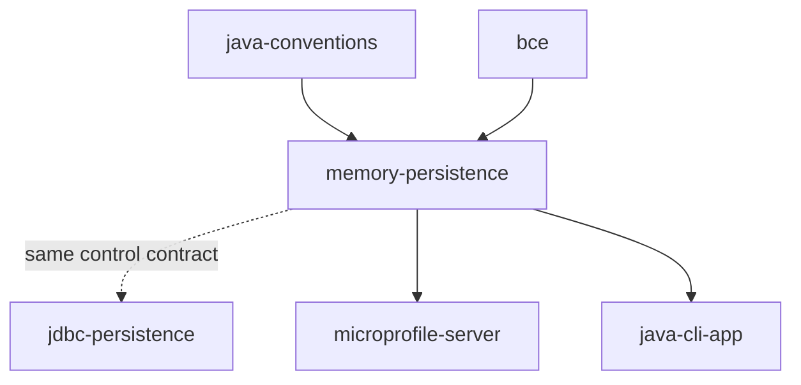

# memory-persistence

An [AIrails.dev](https://airails.dev) skill for storing Java records in plain `java.util` collections, following Data-Oriented Programming: a `ConcurrentHashMap` keyed by id is the table, the immutable record is the row, and a query is a stream. The control exposes the same contract as [`jdbc-persistence`](../jdbc-persistence), so a BC starts in memory and moves to a database by replacing one class.

## Scope

- Records and sealed interfaces in `entity`, identical to the JDBC variant
- One control per aggregate root holding a `ConcurrentHashMap` and an `AtomicLong` sequence; `save`, `update`, `findById`, `all`, named query methods as streams
- Explicit enforcement of what a schema would enforce: uniqueness rules throw `IllegalArgumentException`
- No locks, no mutable statics, no live collection leaving the control
- Opt-in JSON snapshot for demos that must survive a restart
- Plain-object unit tests without a container

Not for durable storage — use `jdbc-persistence`.

## Composition



[`bce`](../../bce/bce) owns placement, [`java-conventions`](../java-conventions) owns style, and the stack skill — [`microprofile-server`](../../bce/microprofile-server) or [`java-cli-app`](../../bce/java-cli-app) — owns lifecycle and the test loop.

## Usage

Activated for prototypes, demos, the first `sbce` convergence of a BC, or when a database is not available yet. The rules in [SKILL.md](SKILL.md) guide generation and review.

## Test

Clone the server sample:

```
git clone https://github.com/adambien/quarkus-microprofile
```

Then use the following prompt:

```
store the coffee BC in memory
```
